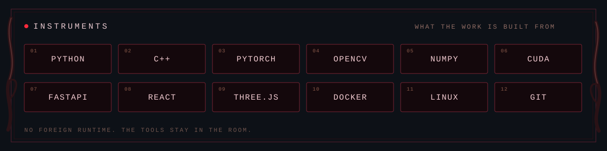

Engineering student at [Thapar Institute of Engineering and Technology](https://www.thapar.edu/)

 

[LINKEDIN](https://www.linkedin.com/in/andrew-prakash-2687a2242/)
&nbsp;&nbsp;·&nbsp;&nbsp;
[X](https://x.com/AndrewBenj71771)
&nbsp;&nbsp;·&nbsp;&nbsp;
[GITHUB](https://github.com/AndrewPrakash1)

 

> I build systems that turn real-world signals into **measurable** models — not just demos.
>
> Somewhere under the noise there is a number that stays true when the room goes quiet. That is the work.

### Case files

| No. | File | What it holds |
| --- | --- | --- |
| 001 | [**OnePass**](https://github.com/AndrewPrakash1/drone-video-3d) | Single-pass drone video → georeferenced, measurable 3D |
| 002 | [**Heat Sink**](https://github.com/AndrewPrakash1/Heat_Sink) | Live CPU power → real-time 2D heat-sink temperature field (finite differences) |
| 003 | [**RegIntel**](https://github.com/AndrewPrakash1/RegIntel) | Scrapes regulatory docs and turns them into structured insights |
| 004 | [**GPT from scratch**](https://github.com/AndrewPrakash1/GPT-Implementation) | Decoder-only GPT implemented in Python |
| 005 | [**CricScope**](https://github.com/AndrewPrakash1/CricScope) | Cricket analytics: insights, visuals, and predictions |

 

a note left in the static

 

The lights don't spell anything unless you want them to. The woods in the header are just trees. The red is just a color that remembers every television left on after midnight.

If you build computer vision or machine learning that has to be **correct** — geometry you can measure, heat you can predict, language that was actually learned — the door is already open. Come in quietly.

