# Andrew Prakash

**Computer vision · machine learning**

Engineering student at [Thapar Institute of Engineering and Technology](https://www.thapar.edu/).

[LinkedIn](https://www.linkedin.com/in/andrew-prakash-2687a2242/) · [X](https://x.com/AndrewBenj71771) · [GitHub](https://github.com/AndrewPrakash1)

## About

I build systems that turn real-world signals into **measurable** models — not just demos.

The interesting part is the number that is still true when the noise drops out. Geometry you can measure. Heat you can predict. A model that was actually learned.

## Work

| Project | What it is |
| --- | --- |
| [**OnePass**](https://github.com/AndrewPrakash1/drone-video-3d) | Single-pass drone video → georeferenced, measurable 3D |
| [**Heat Sink**](https://github.com/AndrewPrakash1/Heat_Sink) | Live CPU power → real-time 2D heat-sink temperature field (finite differences) |
| [**RegIntel**](https://github.com/AndrewPrakash1/RegIntel) | Scrapes regulatory docs and turns them into structured insights |
| [**GPT from scratch**](https://github.com/AndrewPrakash1/GPT-Implementation) | Decoder-only GPT implemented in Python |
| [**CricScope**](https://github.com/AndrewPrakash1/CricScope) | Cricket analytics: insights, visuals, and predictions |

## Stack

Python · C++ · PyTorch · OpenCV · NumPy · CUDA

FastAPI · React · Three.js · Docker · Linux · Git

---

Open to collaborations on computer vision and ML systems that have to be correct.
